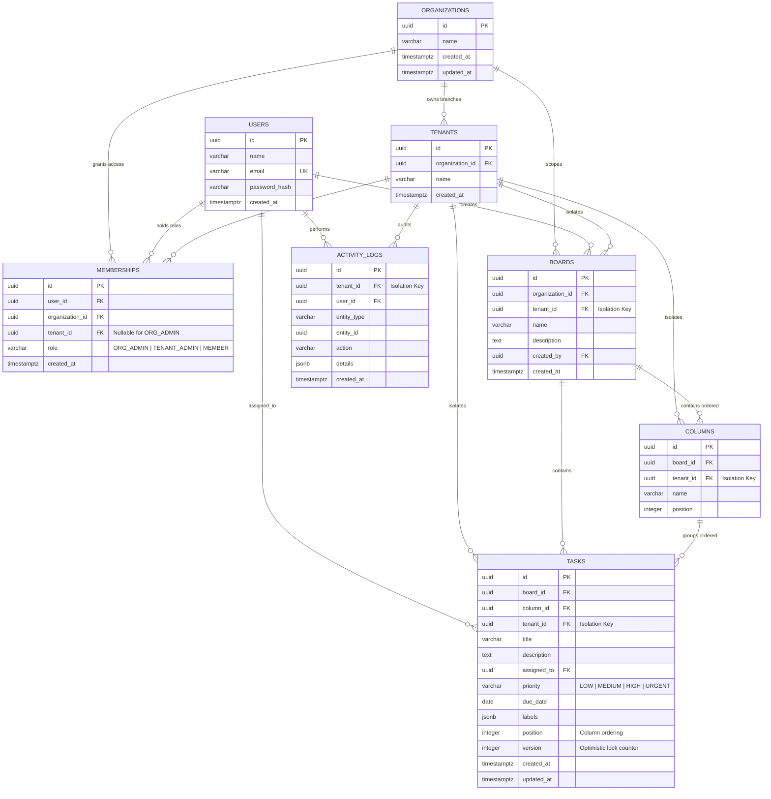

# Database Schema & Entity-Relationship Diagram (ERD)

## 1. Entity Hierarchy & Isolation Invariant

The database enforces strict multi-organization and multi-tenant isolation across **8 normalized relational tables**:

`organizations` (1) ──< `tenants` (1) ──< `boards` (1) ──< `columns` (1) ──< `tasks`

- **`users`** connect to **`organizations`** and **`tenants`** via **`memberships`** (`ORG_ADMIN`, `TENANT_ADMIN`, `MEMBER`).
- Every business record (`boards`, `columns`, `tasks`, `activity_logs`) carries a mandatory `tenant_id` foreign key so every query, mutation, and transaction enforces `WHERE id = $1 AND tenant_id = $2`.

---

## 2. Mermaid Entity-Relationship Diagram

---

## 3. Indexing & Concurrency Design

| Index Name | Target Columns | Purpose |
| --- | --- | --- |
| `idx_tenants_organization_id` | `tenants(organization_id)` | Fast branch lookup when switching organizations |
| `idx_memberships_org_user` | `memberships(organization_id, user_id)` | Sub-millisecond RBAC authorization check on every API & Socket request |
| `idx_memberships_tenant_id` | `memberships(tenant_id)` | Team member roster queries |
| `idx_boards_tenant_id` | `boards(tenant_id)` | Tenant-isolated board listing |
| `idx_columns_board_tenant` | `columns(board_id, tenant_id, position)` | Ordered Kanban column rendering |
| `idx_tasks_column_position` | `tasks(tenant_id, column_id, position)` | Ordered task rendering & transactional drag-and-drop re-indexing |
| `idx_activity_logs_tenant_created` | `activity_logs(tenant_id, created_at DESC)` | Reverse-chronological audit log feed |
